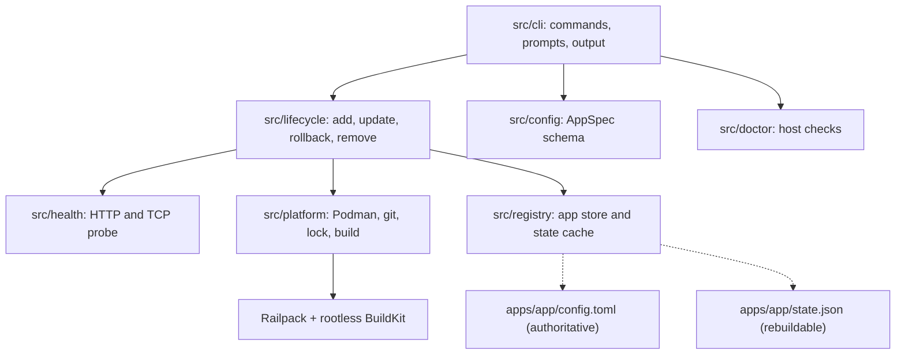

# easy-host

easy-host is a Linux CLI that turns a git repository into a long-running, self-hosted HTTP service on a single machine. It clones the repository, builds an image with Railpack (no per-repo Dockerfile), runs it under rootless Podman with `--restart=always` on one host port you declare, health-gates every update, keeps the last two images for rollback, and never deletes a named volume unless you explicitly ask. It is a hosting tool, not a local development loop: there is no web UI, daemon, scheduler, webhook receiver, TLS terminator, database, or bundled reverse proxy, and a swap briefly stops the old container because the port is fixed.

## Table of contents

- [About](#about)
- [Features](#features)
- [Tech stack](#tech-stack)
- [Architecture](#architecture)
- [Project structure](#project-structure)
- [Getting started](#getting-started)
- [Supported stacks](#supported-stacks)
- [Prerequisites](#prerequisites)
- [Install](#install)
- [Quickstart](#quickstart)
- [Success scenarios](#success-scenarios)
- [Volume safety](#volume-safety)
- [Configuration](#configuration)
- [Security](#security)
- [How to contribute](#how-to-contribute)
- [What's next](#whats-next)
- [License](#license)
- [Acknowledgements](#acknowledgements)
- [Author](#author)
- [Documentation](#documentation)

## About

Self-hosting a small app usually means writing a Dockerfile, remembering the container commands, wiring a restart policy, and hoping the old version is still around when a deploy goes wrong. easy-host collapses that into one command per app and a small, predictable lifecycle:

1. **Register** a repository or local workspace, its host port, and any named volumes.
2. **Build** an immutable image tagged with the UTC build time; no per-repository container file.
3. **Replace** the running container behind a readiness probe, reverting automatically if the candidate cannot serve.
4. **Keep** exactly two images and every named volume, so rollback is one step and data outlives the app.

Everything lives in a per-app directory under one state root. There is no database and no background process: the filesystem is the registry, and every command is a short-lived CLI invocation.

## Features

| Feature | What it does |
| --- | --- |
| Repository to service | Clones a git ref (or uses a local workspace), builds it, and runs it as one container. |
| Dockerfile-free builds | Railpack detects the provider; BuildKit exports the image under rootless Podman. |
| One declared port | Publishes exactly one host port per app; conflicts are rejected before anything is created. |
| Health-gated updates | A candidate must pass an HTTP or TCP readiness probe before it is recorded as current. |
| Automatic revert | A failed start or probe stops the candidate and restarts the previously serving image. |
| One-step rollback | Current and previous images are swapped; a second rollback returns to the newer one. |
| Two-image retention | Disk use stays bounded and old images are pruned only under explicit safety rules. |
| Volume safety | Named volumes survive updates and removal unless `--volumes` is passed with a matching label. |
| Reboot recovery | `--restart=always` plus lingering brings containers back with no easy-host process. |
| Host checks | `doctor` verifies Podman, rootless mode, the image loader, lingering, git, Node, Railpack, BuildKit, and disk. |
| Scriptable output | A fixed eight-code exit taxonomy and `schemaVersion: 1` JSON with secrets redacted. |
| Per-app locking | Overlapping mutations of the same app exit `6` instead of corrupting state. |

## Tech stack

| Layer | Choice |
| --- | --- |
| Language and runtime | TypeScript 7.0.2 on Node.js 24 or newer, ESM |
| CLI | `commander` 15.0.0, `@clack/prompts` 1.8.1, `ora` 9.4.1, `picocolors` 1.1.1 |
| Configuration | `smol-toml` 1.9.1 with a strict `zod` 4.6.7 schema |
| Process execution | `execa` 10.2.1 and argument-array child processes with finite timeouts |
| Container runtime | Rootless Podman `>= 5.7.0, < 6.0.0` |
| Build front end | Railpack `0.43.0`, pinned with per-architecture SHA-256 values |
| Build daemon | `docker.io/moby/buildkit:v0.34.1-rootless`, pinned by digest |
| Tests | Vitest 5.0.5; Biome 2.6.4 for linting and formatting |
| Storage | The filesystem: per-app directories with TOML configuration and a derived JSON cache |

## Architecture

easy-host is a CLI over six internal layers. A mutating command validates first, takes a per-app lock, prepares the workspace, builds or reuses an image, mutates the runtime, probes, persists, and reports. The full module map and contracts are in the [architecture note](docs/ARCHITECTURE.md), and the durable decisions with their trade-offs are in the [ADR index](docs/adr/README.md).



Two boundaries matter most: `config.toml` is authoritative and `state.json` is a cache, and the container runtime is reached only through the narrow Podman adapter. Each has its own record: [ADR-0002](docs/adr/0002-filesystem-registry-derived-state.md) and [ADR-0001](docs/adr/0001-rootless-podman-runtime.md).

## Project structure

- `src/cli/` — command registration, argument parsing, prompts, error mapping, and output rendering.
- `src/config/` — `AppSpec` TOML schema, parsing, name derivation, and environment merging.
- `src/registry/` — app directory store, derived `state.json` cache, drift detection, and port-conflict checks.
- `src/doctor/` — host prerequisite checks and their ordered report.
- `src/platform/` — git, Podman, lock, path, boot-recovery, image-labelling, and build adapters.
- `src/health/` — bounded HTTP and TCP readiness probes.
- `src/lifecycle/` — add, diff, swap, update, rollback, retention, and remove orchestration.
- `src/cli/program.ts` — the one place the ten commands and their flags are declared.
- `fixtures/` — Vite/React, Node/Express, and Python/FastAPI repositories used by the build tests.
- `tests/unit/`, `tests/docs/`, `tests/packaging/`, `tests/integration/` — unit, drift, packaging, and gated host suites.
- `scripts/generate-completions.ts` — writes the bash, zsh, and fish completion files.
- `completions/` — generated shell completions, shipped as files.
- `docs/` — operator guides, references, ADRs, release notes, architecture, and support map.
- `dist/` — the compiled CLI entry point produced by `npm run build`.

## Getting started

Three steps, in order:

1. Check the stack you are deploying against [Supported stacks](#supported-stacks).
2. Prepare the host and satisfy [Prerequisites](#prerequisites), then run `easy-host doctor`.
3. Install with one of the [Install](#install) paths and follow the five-command [Quickstart](#quickstart).

The first `add` is the longest command you will run: it clones, builds, starts, and waits for the readiness probe. Later deploys are usually a single `easy-host update <app>`.

## Supported stacks

Support is claimed only for the stacks the integration suite builds and probes. Railpack may detect other projects, but that is not a support promise.

| Stack | Verified fixture |
| --- | --- |
| Vite/React static SPA | `fixtures/vite-spa` |
| Node/Express | `fixtures/express-api` |
| Python/FastAPI | `fixtures/fastapi-app` |

One repository produces one service. Multi-service and compose-style stacks are out of scope.

## Prerequisites

easy-host targets Linux on x86_64 or arm64 and expects all of the following on the host:

| Requirement | Minimum | Verify |
| --- | --- | --- |
| Rootless Podman | `>= 5.7.0, < 6.0.0` | `podman --version` and `podman info --format '{{.Host.Security.Rootless}}'` (expect `true`) |
| Lingering for the owning user | enabled | `loginctl show-user "$USER" -p Linger` (expect `Linger=yes`) |
| git | 2.40 or newer | `git --version` |
| Node.js | 24 or newer | `node --version` |
| One free host port per app | 1024 or above | choose a free port and pass it with `--port` |

Three points are easy to miss:

- **Podman 6.x is not supported.** The supported range is `>= 5.7.0, < 6.0.0`; the 6.x major line is excluded while it is unstable. The `doctor` check fails on a version outside that range and names the supported range.
- **Lingering is mandatory.** Without lingering, the user's systemd manager does not start at boot, so `--restart=always` containers do not come back after a reboot. Enable it with `sudo loginctl enable-linger "$USER"`. easy-host enables `podman-restart.service` on `add`, but that user unit can only replay containers once lingering has started the user manager.
- **Privileged ports are unsupported.** Rootless Podman cannot bind a port below 1024 without a host-wide sysctl change, which easy-host does not make. Use port 1024 or above.

Run `easy-host doctor` after installing. It checks Podman, rootless mode, a Docker-compatible image loader, lingering, reboot recovery, git, Node.js, Railpack, BuildKit, and disk, and every failing check prints a remediation command. Railpack exports images through a Docker-compatible loader; on the Ubuntu host used for the v0.1.0 release gate, the `podman-docker` package provided that loader. The step-by-step guide, including the Podman 4.9 upgrade path and a verification command for each prerequisite, is [Host prerequisites](docs/operations/prerequisites.md). The verified host evidence is in the [v0.1.0 release-gate record](docs/operations/release-gate-v0.1.0.md).

## Install

Install Node.js 24 or newer first. easy-host is not published to the npm registry; install it globally from a checkout by one of the three supported paths. Replace `<repository-url>` with the clone URL you use for this repository.

**From a clone (current revision):**

```sh
git clone <repository-url> easy-host
cd easy-host
npm install
npm install -g .
```

**From a release tag (`v0.1.0`):**

```sh
git clone --branch v0.1.0 <repository-url> easy-host
cd easy-host
npm install
npm install -g .
```

**From a packed tarball:**

```sh
npm install
npm pack
npm install -g ./easy-host-0.1.0.tgz
```

`npm install` installs the build dependencies, and the package's `prepare` script builds `dist/` before `npm pack` and when installing from a clone. The package is marked `private`, so there is no registry publish path.

No `v0.1.0` git tag exists in this checkout yet. The release-tag path becomes usable only after a maintainer creates the tag; until then, use the clone or tarball path and record the commit you deployed with `git rev-parse HEAD`.

Do not use `npm install -g git+<repository-url>#v0.1.0` as the tag path. npm prepares a git dependency before its devDependencies are available, so that form fails to build; clone the tag and install from the checkout instead.

easy-host keeps its state under `$EASY_HOST_HOME` when set, otherwise `$XDG_DATA_HOME/easy-host`, otherwise `~/.local/share/easy-host`, created with mode `0700`. Each app gets `apps/<name>/config.toml` and its own workspace; there is no database.

Confirm the install with:

```sh
easy-host version
easy-host doctor
```

## Quickstart

These five commands take a repository from clone to a healthy, self-hosted service. The example app name is `blog` and the host port is `8080`; choose a free port at or above 1024.

```sh
easy-host doctor
easy-host add https://github.com/your-org/your-app.git --name blog --port 8080 --yes
easy-host status blog
easy-host logs blog --tail 100
easy-host update blog
```

`doctor` fails before the first `add` if the host is not ready. `add` clones the repository at the configured ref, builds the image, creates the container on `0.0.0.0:8080` by default, and waits for the readiness probe. The success summary prints the URL, image, previous image, and health result. `status` reports the container state, drift, port, and image; `logs` is a `podman logs` passthrough; `update` fetches the ref, rebuilds only when needed, and health-gates the swap.

The app is reachable from another machine on the LAN at `http://<host-lan-address>:8080/`. easy-host publishes the port on the LAN; it does not terminate TLS or act as a reverse proxy, so internet exposure and HTTPS are the operator's responsibility. The [Tailscale guide](docs/operations/tailscale.md) walks through the recommended loopback layout, where the host terminates TLS and the app is reachable only on your tailnet — or on the public internet through Funnel.

easy-host ships no scheduler. To repeat `update` on a schedule, write a systemd user timer that calls it; the [scheduled updates guide](docs/operations/systemd-timer.md) has complete unit files, enable commands, log location, and the lock behavior when runs overlap.

## Success scenarios

The v0.1.0 release gate exercises the four outcomes below on a fresh Linux host with rootless Podman `>= 5.7.0, < 6.0.0`, lingering enabled, and an empty state root. The [release-gate record](docs/operations/release-gate-v0.1.0.md) contains the commands, exit codes, and observed output.

### 1. The app is reachable from another machine

```sh
easy-host add https://github.com/your-org/your-app.git --name blog --port 8080 --yes
curl -fsS http://<host-lan-address>:8080/
```

The `add` exits `0` and the app answers on the published port from a second machine on the LAN. A request to the host's own loopback from that second machine is not expected to answer; use the host's LAN address.

### 2. The app returns after a reboot

Reboot the host and wait for it to come back. With lingering enabled, easy-host has enabled `podman-restart.service`, which replays `--restart=always` containers at boot. No easy-host command is required, and the app answers on the same port.

### 3. A broken update keeps the previous version serving

```sh
git push origin main
easy-host update blog
```

If the candidate image fails to build, `update` exits `3` and the old container is untouched. If the candidate starts but fails the readiness probe, `update` exits `4`, stops the candidate, restarts the previous image, and reports `state: reverted`. In both cases the previous version keeps serving and `status` records the failure.

### 4. Rollback restores the previous image

```sh
easy-host rollback blog
easy-host rollback blog
```

The first rollback swaps the current and previous images, probes the restored image, and exits `0` when it serves. The second rollback returns to the newer image. easy-host retains exactly two images per app; a failed rollback stops the candidate and restarts the image it was trying to leave.

## Volume safety

Declare persistent data as a named volume when you add the app, for example `--volume blog-data:/data`. The same declaration can live in the app's `[volumes]` table. Named volumes survive `update` and `rollback`.

`easy-host remove blog` deletes the container, workspace, app directory, and images, but keeps every named volume and prints the exact command to delete each one, for example:

```sh
podman volume rm easy-host-blog-blog-data
```

`easy-host remove blog --volumes` deletes only the named volumes labelled for that app. It never deletes a host filesystem path, and it refuses a volume whose name merely matches the app pattern but whose `io.easy-host.app` label is missing or different. `--force` skips confirmation prompts but does not imply `--volumes`; without `--force`, a non-interactive `remove` requires `--yes`.

## Configuration

Every app is defined by `<state-root>/apps/<app>/config.toml`. Exactly one of `repo` or `local_path` is required, plus `port`; every other key has a default. The frequently used keys are:

| Key | Default | Purpose |
| --- | --- | --- |
| `ref` | `main` | Git branch, tag, or commit to build. |
| `container_port` | `3000` | Port the app listens on inside the container; injected as `PORT`. |
| `bind` | `0.0.0.0` | Host address for the published port: `0.0.0.0`, `127.0.0.1`, or `::`. |
| `probe` | `http` | Readiness probe type; `http` accepts 2xx/3xx, `tcp` accepts a connection. |
| `health_path` | `/` | HTTP path requested by the probe. |
| `[volumes]` | empty | Named volumes, as `name = "/container/path"`. |
| `[env]` | empty | Non-secret environment entries; values are never printed. |

Environment variables that change CLI behaviour:

| Variable | Effect |
| --- | --- |
| `EASY_HOST_HOME` | State-root override. |
| `XDG_DATA_HOME` | Base for the state root when `EASY_HOST_HOME` is unset. |
| `EASY_HOST_DEBUG=1` | Include diagnostics for unexpected errors, with secrets redacted. |
| `EASY_HOST_NO_PROMPT=1` | Force non-interactive mode. |
| `EASY_HOST_RAILPACK_BIN` | Use an operator-supplied Railpack binary. |
| `EDITOR` | Editor used by `easy-host config <app> --edit`. |
| `NO_COLOR` | Disable colour when set to a non-empty value. |

Edit configuration with `easy-host config <app> --edit`, then apply it with `easy-host update <app>`. The full key table, validation rules, file modes, and environment precedence are in the [configuration reference](docs/reference/config.md); operational configuration is in the [administrator guide](docs/admin-guide.md).

## Security

easy-host has **no authentication or authorization model**. It is a single-user CLI: anyone who can run it as the owning operating-system user controls every app. Shell access to that account is full control of the deployment.

- Containers run rootless, without privileged mode, host networking, or extra capabilities.
- Secrets come from a mode-`0600` file and are passed as environment values. They are never written into `config.toml`, never printed, and replaced with `[redacted]` in JSON output.
- Published ports are plain HTTP. easy-host does not terminate TLS, proxy requests, or manage certificates; a host-level proxy or tunnel is the operator's responsibility.
- `remove` deletes named volumes only with `--volumes` and a matching `io.easy-host.app` label, and never deletes a host filesystem path.
- There is no telemetry. Network access is limited to your git remote, the pinned Railpack release, and the registry used by BuildKit.

Report a vulnerability privately to the maintainer listed under [Author](#author) rather than in a public issue, and include the affected version, reproduction steps, and impact. Hardening detail and the operator checklist are in the [administrator guide](docs/admin-guide.md#security-and-privacy-checklist).

## How to contribute

There is no `CONTRIBUTING.md`; this section is the workflow.

1. Branch from `main` and keep one concern per branch.
2. Install dependencies with `npm install`, then make the change with its tests.
3. Run the gates before opening a pull request:

   ```sh
   npm run typecheck
   npm run lint
   npm test
   ```

4. Run `npm run test:packaging` when you touch packaging or completions, and `EASY_HOST_INTEGRATION=1` suites when you touch containers, builds, or lifecycle behaviour and have a rootless Podman host.
5. Update the documentation in the same change. The docs suite fails when the README, references, guides, or completion files drift from the code.
6. Open a pull request against `main` describing the problem, the change, and the verification you ran. Public contract changes (command, flag, exit code, JSON field, config key, file mode) must be called out explicitly.

The ownership map and review routing are in [Support](docs/SUPPORT.md).

## What's next

These are known gaps, not shipped behavior:

- Publish the `0.1.0` git tag and decide whether the package should be distributed beyond a checkout or tarball.
- Add a continuous-integration workflow; the repository currently has none, so the local suite and the recorded release gate are the evidence.
- Support binding an app to a specific non-loopback address, which needs a configurable probe target first.
- Support binding an app to a specific non-loopback address, which needs a configurable probe target first.
- Multi-service repositories, compose-style stacks, and additional build fixtures.
- A backup, restore, or export command for named volumes.
- Zero-downtime swaps, which would require a second port and a proxy the product deliberately does not ship.
- Support for Podman 6.x once that major line is stable.

## License

easy-host is released under the [MIT License](LICENSE). You may use, copy, modify, merge, publish, distribute, sublicense, and sell copies of the software, provided the copyright notice and permission notice are included. The software is provided without warranty.

Copyright (c) 2026 mcfuzzysquirrel.

## Acknowledgements

easy-host builds on:

- [Railpack](https://railpack.com/) and [BuildKit](https://github.com/moby/buildkit) for Dockerfile-free, rootless image builds.
- [Podman](https://podman.io/) for the rootless container runtime.
- [Node.js](https://nodejs.org/) and [TypeScript](https://www.typescriptlang.org/) for the CLI.
- [commander](https://github.com/tj/commander.js), [Zod](https://zod.dev/), [execa](https://github.com/sindresorhus/execa), [clack](https://github.com/bombshell-dev/clack), [ora](https://github.com/sindresorhus/ora), [picocolors](https://github.com/alexeyraspopov/picocolors), and [smol-toml](https://github.com/squirrelchat/smol-toml).
- [Vitest](https://vitest.dev/) and [Biome](https://biomejs.dev/) for tests and linting.
- The upstream projects behind the fixtures: [Vite](https://vite.dev/), [React](https://react.dev/), [Express](https://expressjs.com/), and [FastAPI](https://fastapi.tiangolo.com/).

## Author

Maintained by **mcfuzzysquirrel**. Report bugs and ask questions through the repository's issue tracker: <https://github.com/McFuzzySquirrel/easy-host/issues>. Security reports should follow [Security](#security).

## Documentation

| Document | Contents |
| --- | --- |
| [User guide](docs/user-guide.md) | App-owner workflows: add, status, logs, update, rollback, remove, and exit codes |
| [Administrator guide](docs/admin-guide.md) | Installation, configuration, secrets, ingress, backups, monitoring, recovery, and hardening |
| [Architecture Decision Records](docs/adr/README.md) | One record per durable decision, with options, consequences, and verification |
| [CLI reference](docs/reference/cli.md) | Every command, flag, argument, exit code, and example |
| [Configuration reference](docs/reference/config.md) | Every `config.toml` key, type, default, validation rule, volume, and env precedence |
| [Host prerequisites and upgrade](docs/operations/prerequisites.md) | Podman support window, the 4.9 upgrade, lingering, git, Node, ports |
| [Scheduled updates with a systemd timer](docs/operations/systemd-timer.md) | User units that call `update`, enable commands, logs, and lock behavior |
| [Reaching an app outside the LAN with Tailscale](docs/operations/tailscale.md) | Loopback bind, `tailscale serve` and `funnel`, ACLs, and troubleshooting |
| [Changelog](CHANGELOG.md) | Notable changes, by version |
| [Release notes: 0.1.0](docs/releases/v0.1.0.md) | Highlights, compatibility, limitations, and validation evidence |
| [v0.1.0 release-gate record](docs/operations/release-gate-v0.1.0.md) | Verified host, commands, and observed results |
| [Architecture](docs/ARCHITECTURE.md) | Module map, on-disk state, build layer, lifecycle, exit codes |
| [Support](docs/SUPPORT.md) | Who owns what, intake, and the release checklist |
| [Migration note](docs/MIGRATION.md) | The rename, the manual repository rename, and changes for early users |

Shell completions are shipped as generated files: [bash](completions/easy-host.bash), [zsh](completions/easy-host.zsh), and [fish](completions/easy-host.fish). Each file's header names its install location. There is no completion subcommand.
