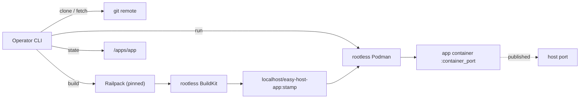

# Administrator Guide

This guide is for the person who owns the host that runs easy-host: installing it, keeping Podman healthy, deciding what is exposed, protecting secrets and data, and recovering from failures. App-owner workflows are in the [User Guide](user-guide.md); exact flags and exit codes are in the [CLI reference](reference/cli.md).

## Responsibilities and Architecture

easy-host is a single-user CLI, not a service. There is no daemon, scheduler, web UI, database, or remote API, and no component of easy-host keeps running between commands. The host administrator owns everything around it:

- the Podman installation, rootless configuration, and user lingering;
- the state root, its permissions, and its backups;
- what the published ports are reachable from, including firewalls, TLS, and ingress;
- the git remotes and registry access used during builds;
- disk capacity for images, build cache, and named volumes.

Per command, the flow is: preflight and validation, per-app lock, prepare, build or reuse, mutate, probe, persist, report. The module map and on-disk contract are in the [architecture note](ARCHITECTURE.md); the durable choices behind them are in the [ADR index](adr/README.md).



## Prerequisites

The supported baseline is Linux on `x86_64` or `aarch64` with:

| Requirement | Minimum | Verify |
| --- | --- | --- |
| Rootless Podman | `>= 5.7.0, < 6.0.0` | `podman --version`; `podman info --format '{{.Host.Security.Rootless}}'` returns `true` |
| User lingering | enabled | `loginctl show-user "$USER" -p Linger` returns `Linger=yes` |
| git | 2.40 | `git --version` |
| Node.js | 24 | `node --version` |
| Docker-compatible image loader | present | `easy-host doctor` reports `docker-loader` |
| Free host port per app | 1024 to 65535 | choose a port and pass `--port` |
| Disk | room for two app images plus build cache | `easy-host doctor` reports the disk check |

Podman 6.x is excluded while that major line is unstable. Privileged ports are unsupported: rootless Podman cannot bind below `1024` without a host-wide sysctl that easy-host does not change. Lingering is mandatory because `--restart=always` containers are replayed by the user's `podman-restart.service`, which only exists after the user manager starts at boot.

`easy-host doctor` checks ten things in order and prints a remediation command for each failure: `podman`, `podman-rootless`, `docker-loader`, `linger`, `boot-restart`, `git`, `node`, `railpack`, `buildkit`, and `disk`. It never installs software or starts a daemon. The step-by-step upgrade paths are in [Host prerequisites](operations/prerequisites.md).

## Installation

Install Node.js 24 or newer, then install easy-host from a checkout. The package is marked `private`, so there is no npm registry path.

**From a clone (current revision):**

```sh
git clone <repository-url> easy-host
cd easy-host
npm install
npm install -g .
```

**From a release tag:**

```sh
git clone --branch v0.1.0 <repository-url> easy-host
cd easy-host
npm install
npm install -g .
```

**From a packed tarball:**

```sh
npm install
npm pack
npm install -g ./easy-host-0.1.0.tgz
```

The `prepare` script builds `dist/` during `npm pack` and when installing from a clone. Do not use `npm install -g git+<repository-url>#v0.1.0`: npm prepares a git dependency before devDependencies are available, so that form fails to build.

No `v0.1.0` git tag exists in this checkout. The release-tag path works only after a maintainer creates the tag; until then use the clone or tarball path and record the commit you deployed (`git rev-parse HEAD`).

Verify the install and the host:

```sh
easy-host version
easy-host doctor
```

easy-host never needs root. Install it and run it as the same unprivileged user that owns the apps; running some commands with `sudo` would create a second state root the user's commands cannot read.

## Configuration

### State root

The state root resolves in this order:

1. `EASY_HOST_HOME` when set and non-empty;
2. `$XDG_DATA_HOME/easy-host`;
3. `~/.local/share/easy-host`.

It is created with mode `0700`. Each app lives at `<state-root>/apps/<app>/` with `config.toml` (`0644`), `secrets.env` (`0600`), `workspace/`, and `state.json` (`0644`, a rebuildable cache). The filesystem is the registry: `config.toml` is authoritative, and `state.json` may be deleted at any time.

Pick one state root per host and keep it stable. Changing `EASY_HOST_HOME` between commands changes where the CLI looks, so apps under the previous root become invisible to the new one.

### Environment variables

| Variable | Effect |
| --- | --- |
| `EASY_HOST_HOME` | State-root override. |
| `XDG_DATA_HOME` | Base for the state root when `EASY_HOST_HOME` is unset. |
| `EASY_HOST_DEBUG=1` | Include diagnostics and a stack trace for unexpected errors; secrets stay redacted. |
| `EASY_HOST_NO_PROMPT=1` | Force non-interactive mode even on a terminal. |
| `EASY_HOST_RAILPACK_BIN` | Use an operator-supplied Railpack binary instead of the pinned download. |
| `EDITOR` | Editor used by `easy-host config <app> --edit`. |
| `NO_COLOR` | Disable colour when set to a non-empty value. |

### App configuration

Each app's `config.toml` requires exactly one of `repo` or `local_path`, plus `port`. Everything else has a default: `ref=main`, `container_port=3000`, `bind=0.0.0.0`, `probe=http`, `health_path=/`, a 2-second probe interval, a 5-second attempt timeout, and a 90-second startup budget. Host ports are `1024` to `65535` and must be unique across apps regardless of bind address.

Configuration is applied by `update`, not by `config`:

```sh
easy-host config blog --edit
easy-host update blog
```

`bind` accepts only `0.0.0.0`, `127.0.0.1`, and `::`. The readiness probe always targets `127.0.0.1:<port>`, so an app must be reachable there for `add`, `update`, and `rollback` to succeed. The full key table and validation rules are in the [configuration reference](reference/config.md).

## Identity, Secrets, and TLS

easy-host has **no authentication or authorization model**. It does not create users, roles, tokens, or sessions, and it does not expose an API. Anyone who can run the CLI as the owning OS user can control every app. Treat shell access to that account as full control of the deployment.

Secrets:

- The secrets file defaults to `secrets.env` and is selected by `env_file`. When `env_file` is declared, `add` creates an empty file with mode `0600` if none exists; a missing default `secrets.env` is tolerated, but a missing file that `config.toml` declares is a usage error (exit `1`).
- Precedence is `[env]`, then the secrets file, then `PORT`, which easy-host always sets to `container_port`. Later layers win.
- Values are passed to the container environment. They are never written into `config.toml`, never printed, and replaced with `[redacted]` in JSON output.
- easy-host does not encrypt secrets at rest. File permissions, disk encryption, and host access control are the protections.

TLS and ingress:

- easy-host does not terminate TLS, run a reverse proxy, or manage certificates. Published ports are plain HTTP.
- `bind = "0.0.0.0"` exposes the port on every host interface, including the LAN and any tailnet. `bind = "127.0.0.1"` keeps it local and is the right choice when a host-level proxy terminates TLS.
- The [Tailscale guide](operations/tailscale.md) shows the loopback layout with `tailscale serve` for TLS and MagicDNS, and `tailscale funnel` for public exposure.
- Firewall the published port independently of Tailscale. Tailscale ACLs do not close a LAN-facing socket.

Do not expose an app directly to the internet without deciding who should reach it. easy-host adds no rate limiting, WAF, or authentication.

## Storage and Backups

State to back up:

| Data | Location | Rebuildable |
| --- | --- | --- |
| App definitions | `<state-root>/apps/<app>/config.toml` | No; re-add the app if lost. |
| Secrets | `<state-root>/apps/<app>/secrets.env` | No; keep a separate copy. |
| App data | Named Podman volumes (`easy-host-<app>-<name>`) | No. |
| Images | Podman image store | Yes, by rebuilding. |
| `state.json` | Beside each app | Yes, automatically. |
| Workspace checkout | `<state-root>/apps/<app>/workspace/` | Yes, by cloning again. |

easy-host has **no backup, restore, or export command**. A workable procedure:

1. Quiesce writes to the app. There is no drain command, so either accept that backup is point-in-time or stop the app's container with Podman and restart it afterwards.
2. Copy `config.toml` and `secrets.env` for every app, preserving modes (`0600` for secrets).
3. Export each named volume with Podman's own tooling, for example `podman volume export easy-host-blog-data -o blog-data.tar`, or copy the volume's mountpoint from `podman volume inspect`.
4. Record the image references from `easy-host status --json` if you need to reproduce the exact build rather than rebuild a ref.
5. Restore by recreating the volumes, placing the app files under the same paths, and running `easy-host update <app>` to recreate the container; `add` is only for apps that are not in the state root.

Backing up is an operator responsibility. Test a restore on a non-production host before relying on it.

## Health Checks and Monitoring

easy-host has no metrics endpoint, alerting, or monitoring daemon. It records health and reports it on demand:

- The readiness probe is HTTP (2xx/3xx is healthy) or TCP, targeting `127.0.0.1:<port><health_path>` with a 2-second interval, a 5-second attempt timeout, and a 90-second startup budget. These are configurable per app.
- `easy-host status <app>` exits `4` for an unhealthy, stopped, or missing app. `easy-host status` reports every app.
- `easy-host status --json` is the machine-readable form for cron, a monitoring agent, or a systemd timer.
- `easy-host doctor` checks the host, not the apps, and exits `2` when any check fails.
- `update` and `rollback` health-gate the swap and exit `4` when the candidate or restored image cannot serve.

A minimal check:

```sh
easy-host status blog --json >/dev/null
```

A non-zero exit is the signal; wire it into whatever alerting you already run. For scheduled updates, use a systemd user timer as described in [Scheduled updates](operations/systemd-timer.md); easy-host ships no scheduler.

## Upgrades and Rollback

There are two independent rollback stories:

**App versions.** `easy-host rollback <app>` swaps the current and previous images and probes the restored one. easy-host retains exactly two images per app, so one rollback step is available in each direction. A failed rollback exits `4` and restarts the image it was leaving.

**easy-host itself.** Install the new revision over the old one (`git pull`, then `npm install -g .`, or install a newer tarball), then run `easy-host version` and `easy-host doctor`. There is no migration step and no database: app state is plain files, and `state.json` is a cache that is rebuilt when it is missing or unreadable. Keep the previous checkout or tarball if you need to reinstall it.

Before upgrading easy-host:

1. Read `CHANGELOG.md` for the version you are installing.
2. Confirm the host still satisfies the Podman support window; a host upgrade that moves Podman to 6.x is unsupported until the window changes.
3. Back up the state root and secrets.
4. Run `easy-host doctor` once the new binary is installed.

Upgrading easy-host does not restart app containers. App behaviour changes only when you run `update` or `rollback`.

## Troubleshooting

| Symptom | Likely cause | Action |
| --- | --- | --- |
| `doctor` exits `2` on `podman` | Podman missing or outside `>= 5.7.0, < 6.0.0` | Follow the remediation line; see [Host prerequisites](operations/prerequisites.md). |
| `doctor` fails `podman-rootless` | Running as root or with a rootful socket | Run as the unprivileged app user with a rootless Podman. |
| `doctor` fails `linger` | Lingering disabled | `sudo loginctl enable-linger "$USER"`. |
| `doctor` fails `docker-loader` | Railpack cannot export images | Install a Docker-compatible loader (`podman-docker` on the gate host). |
| `doctor` fails `buildkit` | BuildKit socket or image unavailable | Re-run; check disk and that BuildKit can start rootless. |
| `add` or `update` exits `2` | Host prerequisite or state-root permission problem | Run `doctor`; check the state root is owned by the running user and mode `0700`. |
| `add` exits `6` with `PORT_CONFLICT` | Another app declares the same host port | Change one app's port; the rule ignores bind addresses. |
| A command exits `6` with `LOCK_HELD` | Another mutation of the same app is running | Wait; a lock whose process is gone is reclaimed automatically. If it persists, inspect the lock file under the app directory. |
| `status` shows drift | The container or image no longer matches the recorded state | `update` recreates it; drift is reported, not silently repaired. |
| `state.json` is corrupt or missing | Cache damage or a manual edit | Nothing to do: the next read rebuilds it. |
| Disk full during a build | Images and build cache accumulated | `podman image prune` for unused images, and remove apps you no longer need. |
| An app does not return after reboot | Lingering disabled or `podman-restart.service` not enabled | Check `loginctl show-user "$USER" -p Linger` and `systemctl --user status podman-restart.service`. |
| Every command sees no apps | Different `EASY_HOST_HOME` or user | Compare `env \| grep EASY_HOST` and the resolved home with the state root you expect; commands look only in the root they resolve. |

Unexpected errors exit `7` with a bug-report hint instead of a stack trace. Re-run with `EASY_HOST_DEBUG=1` and capture the output; secrets remain redacted.

## Security and Privacy Checklist

- [ ] easy-host is installed and run as one unprivileged user, never with `sudo`, and never as root.
- [ ] Podman is rootless and within the supported version window.
- [ ] Lingering is enabled for that user, and `podman-restart.service` is active.
- [ ] The state root is on a trusted filesystem, mode `0700`, owned by the app user.
- [ ] `secrets.env` files are mode `0600` and excluded from backups that leave the host unencrypted.
- [ ] Every published port is intentional; `127.0.0.1` is used wherever a proxy provides ingress.
- [ ] A host firewall restricts published ports to the interfaces that should reach them.
- [ ] TLS is terminated by an operator-controlled proxy or tunnel; no app is assumed to have HTTPS.
- [ ] Public exposure (including Funnel) has been reviewed for authentication and rate limiting at the app or proxy layer.
- [ ] App containers are never started with `--privileged`, host networking, or extra capabilities.
- [ ] Named volumes are backed up, and restore has been tested.
- [ ] `easy-host doctor`, `easy-host status`, and the test suite are run after host or version changes.
- [ ] Reports and logs are scrubbed of tokens, URLs with credentials, and environment values before sharing.

## Recovery and Support

**Host reboot.** Containers with `--restart=always` are replayed by `podman-restart.service` once the user manager starts. No easy-host command is required. If an app is missing after boot, check lingering first.

**Stale lock.** A lock records the holder's pid and start time. A lock whose pid is gone is reclaimed on the next mutation. If a stale file persists with a live-looking pid, confirm no easy-host process is running before removing it.

**Corrupt cache.** Delete `state.json`; the next command rebuilds it from `config.toml` and the runtime. Deleting it loses no app definition.

**Lost configuration.** There is no recovery for a deleted `config.toml` or `secrets.env` beyond your backup. Re-add the app if the source and port are known; secrets that were never backed up cannot be recovered.

**Lost volume.** There is no restore command. Recreate the volume from your backup, then `update` the app so it mounts the volume again.

**Support.** The ownership map, intake steps, and release checklist are in [Support](SUPPORT.md). Capture the command, app name, expected and observed output, exit code, `easy-host version`, `easy-host doctor`, and host facts. Cross-module or contract changes go through the support lead; product and scope decisions belong to the maintainer.

## Related Documentation

- [Host prerequisites](operations/prerequisites.md) for the Podman window, upgrade paths, and per-prerequisite verification.
- [Configuration reference](reference/config.md) for every key, default, and file mode.
- [CLI reference](reference/cli.md) for every command, flag, and exit code.
- [Scheduled updates](operations/systemd-timer.md) for a systemd user timer around `update`.
- [Tailscale guide](operations/tailscale.md) for TLS and remote access without a bundled proxy.
- [Architecture](ARCHITECTURE.md) and the [ADR index](adr/README.md) for the design and its rationale.
- [Migration note](MIGRATION.md) for the rename and the early-user changes.
